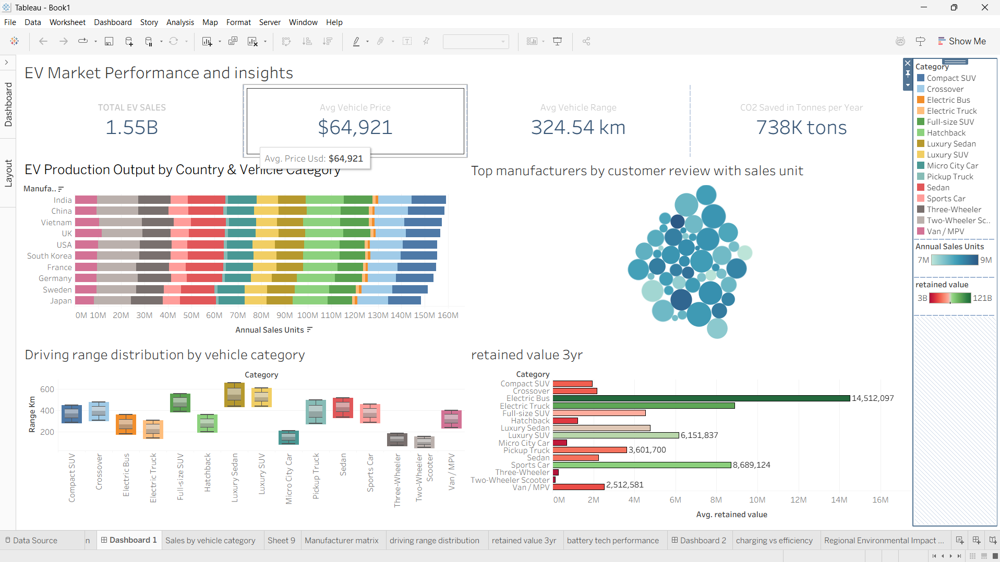
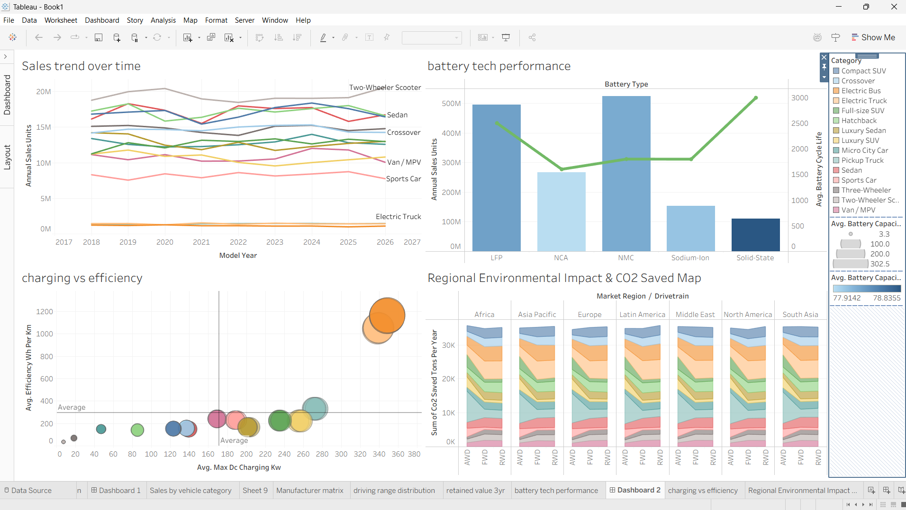

# EV Market Performance and Insights

An interactive **Tableau** project that analyses the global electric vehicle (EV) market: sales, manufacturers, battery technology, driving range, charging efficiency and environmental impact. It is built as two dashboards for executives, business intelligence analysts and sustainability researchers.

> ## 🔗 Live Dashboard on Tableau Public
> ### 👉 **[Open the interactive dashboard](https://public.tableau.com/views/HarshalParetadataanalyticswithtableauSmartbridge/Dashboard1)**
> `https://public.tableau.com/views/HarshalParetadataanalyticswithtableauSmartbridge/Dashboard1`

---

## Headline KPIs

| Total EV Sales | Avg Vehicle Price | Avg Vehicle Range | CO2 Saved per Year |
|:---:|:---:|:---:|:---:|
| **1.55B** | **$64,921** | **324.54 km** | **738K tons** |

---

## Dashboard 1: Market, Manufacturers and Value



| Chart | Type | What it shows |
|---|---|---|
| **KPI cards** | Text tiles | Total EV sales, average price, average range and CO2 saved per year at a glance. |
| **EV Production Output by Country & Vehicle Category** | Stacked horizontal bar | Annual sales units for each country (India, China, Vietnam, UK, USA, South Korea, France, Germany, Sweden, Japan), split by vehicle category. |
| **Top Manufacturers by Customer Review with Sales Unit** | Packed bubbles | Each bubble is a manufacturer; size and shade show annual sales units, so leaders stand out. |
| **Driving Range Distribution by Vehicle Category** | Box plot | The spread of range (km) within each vehicle category, from compact SUVs to two-wheelers. |
| **Retained Value (3 Years)** | Horizontal bar | Average retained value by vehicle category after three years, colored from low to high. |

## Dashboard 2: Trends, Technology and Sustainability



| Chart | Type | What it shows |
|---|---|---|
| **Sales Trend over Time** | Multi-line chart | Annual sales units by vehicle category across model years 2017 to 2027. |
| **Battery Tech Performance** | Bar + line (dual axis) | Annual sales for LFP, NCA, NMC, Sodium-Ion and Solid-State batteries, with average battery cycle life as a line. |
| **Charging vs Efficiency** | Bubble scatter plot | Average max DC charging power (kW) against energy efficiency (Wh per km), with average reference lines. |
| **Regional Environmental Impact & CO2 Saved** | Stacked area | CO2 saved (tons per year) by market region and drivetrain (AWD, FWD, RWD). |

A shared **Category legend** filters and highlights every chart by vehicle category.

---

## Business Questions Answered

- Which vehicle categories and countries drive EV sales and production?
- Which manufacturers lead on sales and customer reviews?
- How does driving range and 3-year retained value differ by category?
- How have sales changed over time, and which battery technologies lead?
- How are charging power and efficiency related?
- How much CO2 is saved in each region and drivetrain?

## Built With

- **Tableau Desktop** (worksheets, calculated fields, dashboards)
- **Tableau Public** (hosting and sharing)

## Repository Structure

```
├── README.md
└── images/
    ├── dashboard-1.png
    └── dashboard-2.png
```

## Author

**Harshal Pareta**: Data Analytics with Tableau project (SmartBridge).
